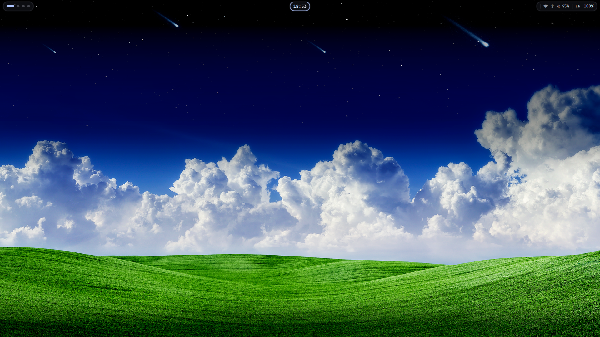
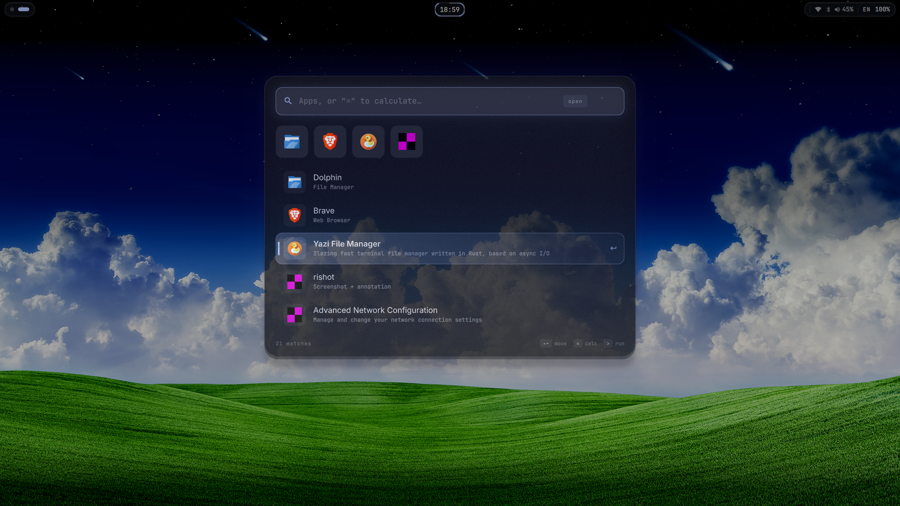
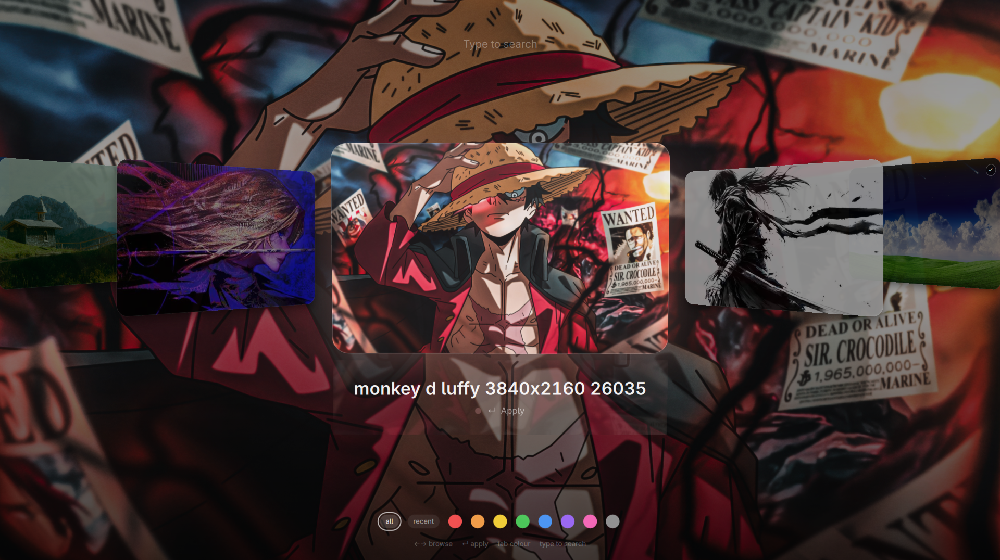
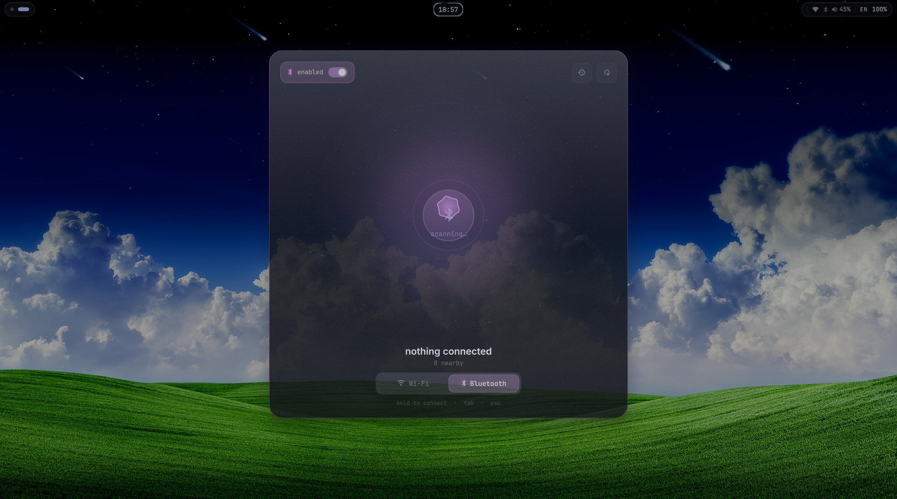
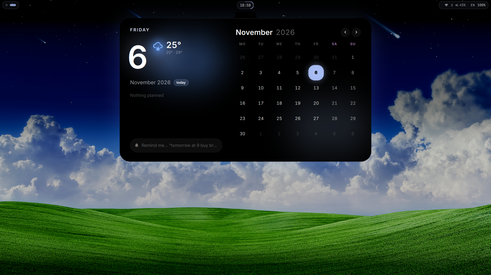
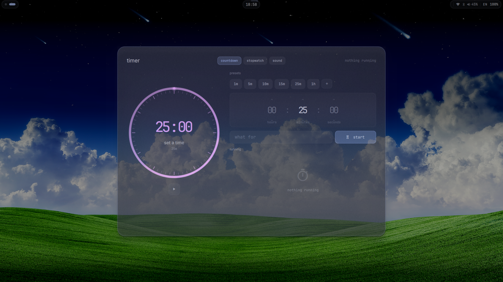
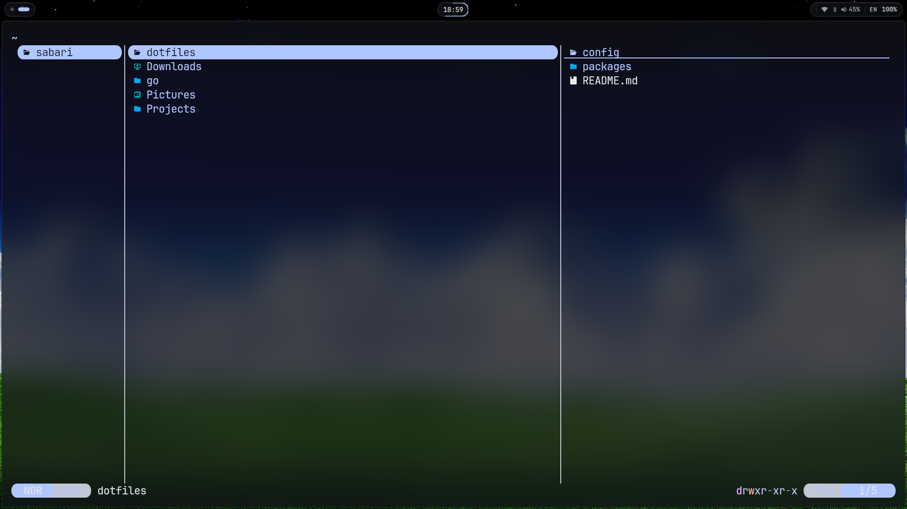

# Sabari’s dotfiles

My Arch Linux setup with Hyprland and Quickshell.

## What's included

- **Hyprland** — window management, keybindings, and display settings.
- **Quickshell** — bar, app launcher, wallpaper picker, Bluetooth controls, calendar, and timer.
- **Kitty, Neovim, Zsh, and Fastfetch** — terminal, editor, shell, and system info configs.
- **Packages** — official and AUR package lists in [`packages/`](packages/).
- **Wallpapers** — images in [`wallpapers/`](wallpapers/), linked from `~/Pictures/Wallpapers`.
- **btop, Cava, GTK, PipeWire, and Rishot** — application preferences and audio configuration.
- **Desktop integration** — Brave flags, default applications, Code OSS font settings, and wallpaper theme templates/helpers.

Configuration lives under `config/`, linked from the matching path in `~/.config`.
Code OSS links only `User/settings.json`; `session/theme-sync` links individual
templates and helpers so session state stays outside the repository. Original
files replaced during this import are retained in `~/.config/dotfiles-backups/`.

`~/Pictures/Wallpapers` points to this repository's `wallpapers/` directory. Images
added through either path appear in the repository automatically; commit and push
them to save them in Git. On a fresh setup, link it with
`ln -s "$(pwd)/wallpapers" ~/Pictures/Wallpapers` from the repository root, after
moving any existing wallpaper folder aside.

Wallpaper theme sources are in `config/session/theme-sync/`. Matugen writes
`generated.css` and `Wallpaper.colors` there at runtime; these palettes are
ignored by Git. On a fresh setup, generate the palette with Quickshell/Matugen
before starting GTK applications. GTK settings also use the local Quickshell-A/B
theme wrappers, which must be installed under `~/.local/share/themes/`.

## Screenshots

### Desktop

### App launcher

### Wallpaper picker

### Bluetooth

### Calendar

### Timer

### Yazi

## Credits

Reference: [fedyaqq34356/hyprdots](https://github.com/fedyaqq34356/hyprdots/tree/main).
Quickshell panel components are adapted from hyprdots;
